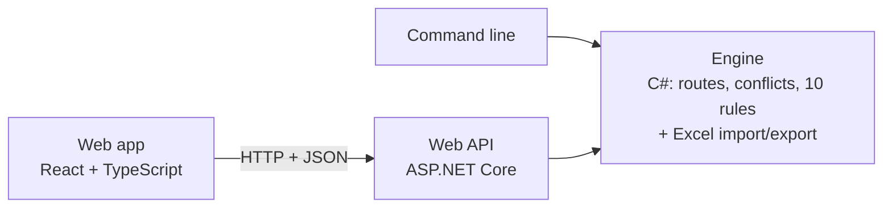

# SignalSafe

[](https://github.com/velam-varsha/signalsafe/actions/workflows/ci.yml)
[](https://github.com/velam-varsha/signalsafe/actions/workflows/deploy.yml)

**[Live demo](https://white-ground-095510a0f.8.azurestaticapps.net/)** · **[API documentation (Swagger)](https://signalsafe-api.bluedesert-a11ee586.uksouth.azurecontainerapps.io/swagger)**

Hosted on Azure (Static Web Apps + Container Apps). The API sleeps when idle, so the first load can take 10–20 seconds.

**A spell-checker for railway signalling data.** SignalSafe reads a track layout, works out every route the layout allows, and checks the designer's control tables against it to find missing routes, wrong point positions, unlisted conflicts and missing overlaps.

> Portfolio project. All layouts and tables in this repository are invented examples. SignalSafe is an advisory design-checking aid, **not** a certified safety system, and does not replace independent checking or formal verification.

## Documentation

| Guide | Read it to... |
| --- | --- |
| [Documentation index](docs/README.md) | Find the right guide, with a suggested reading order |
| [The SignalSafe journey](docs/PROJECT-JOURNEY.md) | Understand how the project was built, step by step, and why each step matters |
| [How SignalSafe works](docs/ARCHITECTURE.md) | See the big picture in diagrams, which file does what, and a code reading order |
| [Testing guide](TESTING.md) | Try it (live or on your machine), run the tests and experiments, send feedback |
| [Development workflow](docs/WORKFLOW.md) | Make a change and get it onto the live site; roll back; add a rule or sample |
| [Deployment](docs/DEPLOYMENT.md) | How it runs on Azure, the pipeline, costs, the free credit, maintenance |
| [Glossary](docs/GLOSSARY.md) | Railway, software and cloud terms in plain English |
| [Web app](frontend/README.md) | Run and develop the React web app |



## Tech stack

| Layer | Technology |
| --- | --- |
| Engine | C# 14, .NET 10 class libraries |
| Excel | ClosedXML |
| API | ASP.NET Core minimal APIs, OpenAPI, Swagger UI |
| Web app | React 19, TypeScript, Vite, SVG |
| Tests | xUnit, FluentAssertions, WebApplicationFactory, Vitest, Testing Library |
| Quality | `dotnet format`, .NET analyzers (warnings as errors), oxlint, code coverage |
| Packaging | Docker (multi-stage builds), docker compose, nginx |
| CI/CD | GitHub Actions: CI on every push, deploy after CI passes on `main` |
| Hosting | Azure Container Apps (API), Azure Static Web Apps (web app), GitHub Container Registry (images) |

**Quality at a glance:** 109 automated tests (72 engine, 14 API, 23 web app), about 95% engine line coverage, and a 500-route layout checked in well under a second.

## Status

All four phases are complete. The [project journey](docs/PROJECT-JOURNEY.md) explains what each one involved and why.

| Phase | Scope | Status |
| --- | --- | --- |
| Week 1 | Core model, layout validation, route search, conflicts | Done (31 tests, 96% line coverage) |
| Week 2 | Excel control table import, rules R01–R10, Excel findings report | Done (67 tests, 94% line coverage) |
| Week 3 | ASP.NET Core API, React + TypeScript web app with interactive schematic | Done (86 .NET + 13 web tests) |
| Week 4 | Route simulator, Docker, CI/CD, public deployment | Done: live on Azure, deployed automatically after CI |

## How it works

1. **Load** a layout from JSON: track sections, points (including crossover pairs) and signals.
2. **Validate** it with 13 checks: unique IDs, points wired to the right sections, crossover ends linked both ways, signals on real joints.
3. **Build a graph** where track sections are edges and joints/points are nodes.
4. **Search** depth-first from every signal in its direction of travel. At facing points the search tries both Normal and Reverse; at trailing points it records the position the train needs. The route ends at the next signal reading the same way. The two ends of a crossover are always called together.
5. **Find conflicts**: route pairs that share a section or need the same points in opposite positions. Pairs that use a section in opposite directions are marked as opposing (head-on).
6. **Work out flank protection**: for trailing points on a route, walk back along the other leg to the signal or points that can stop a movement running into the side of the route.
7. **Read the control tables** from the Excel template and **check them** against the derived data with 10 rules.

## The 10 rules

| Rule | Name | Checks that... | Severity |
| --- | --- | --- | --- |
| R01 | Missing route | every route the layout allows is in the control tables | Warning |
| R02 | Impossible route | every route in the tables exists in the layout | Error |
| R03 | Point position | each route calls every points on its path, in the right position | Error |
| R04 | Track clearance | each route requires every section on its path to be clear | Error |
| R05 | Conflicting routes | routes sharing track or needing opposite points list each other | Error |
| R06 | Opposing routes | head-on routes over the same track list each other | Error |
| R07 | Overlap | each route lists the overlap beyond its exit signal | Error |
| R08 | Flank protection | points that protect the side of a route are held in the right position | Error |
| R09 | Crossover pairing | both ends of a crossover are called, in the same position | Error |
| R10 | Data consistency | no unknown IDs (with "did you mean" hints), duplicates or unreadable cells | Warning |

Rows are matched to derived routes by entrance and exit signal, so a designer's own route names work. Each rule is one class in [`src/SignalSafe.Core/Rules`](src/SignalSafe.Core/Rules).

## Sample layouts

| Sample | What it shows | Routes | Conflicts |
| --- | --- | --- | --- |
| [Westbrook Junction](samples/westbrook-junction.json) | Junction to a branch, a siding with a shunt signal | 5 | 2 |
| [Kestrel Lane Crossover](samples/kestrel-lane-crossover.json) | Double line with a crossover and wrong-direction moves | 5 | 5 (3 head-on) |

Each layout has example control tables with deliberate mistakes: [westbrook-control-tables.xlsx](samples/westbrook-control-tables.xlsx) (7 findings) and [kestrel-control-tables.xlsx](samples/kestrel-control-tables.xlsx) (1 finding). A [blank template](samples/control-table-template.xlsx) is included. The examples are generated by [`tools/make-samples.cs`](tools/make-samples.cs).

A generated test layout with 500 routes is derived and checked for conflicts in well under a second.

## Current simplifications

These are deliberate for the MVP and will be refined:

- The overlap of a route is the single section beyond its exit signal.
- Conflicts compare route paths (shared sections, points needed in opposite positions); overlaps are not compared yet.
- Flank protection is worked out for trailing points only.
- A signal reading towards a line end or buffer stop, with no signal beyond, starts no route.

## Run it

| Option | Needs | Best for |
| --- | --- | --- |
| [Live demo](https://white-ground-095510a0f.8.azurestaticapps.net/) | A browser | Trying it |
| Docker (below) | Docker Desktop | Running the whole app with one command |
| Two terminals (below) | .NET 10 SDK, Node.js 22 | Developing and changing the code |
| Command line (below) | .NET 10 SDK | Checking files quickly, scripting |

### Everything with Docker (one command)

With [Docker Desktop](https://www.docker.com/products/docker-desktop/) running:

```bash
docker compose up --build
```

Open http://localhost:8080 for the web app and http://localhost:5080/swagger for the API documentation. Stop with Ctrl+C.

### Web app for development

Start the API, then the web app in a second terminal, and open http://localhost:5173:

```bash
dotnet run --project src/SignalSafe.Api
```

```bash
cd frontend && npm install && npm run dev
```

The API documentation (Swagger) is at http://localhost:5080/swagger. The web app needs [Node.js 22](https://nodejs.org/) or later.

### Tests and command line

Requires the [.NET 10 SDK](https://dotnet.microsoft.com/download/dotnet/10.0) (Windows, macOS or Linux).

```bash
dotnet test
```

Check a layout and print its routes and conflicts:

```bash
dotnet run --project src/SignalSafe.Cli -- check samples/westbrook-junction.json
```

Check control tables against the layout, and write an Excel findings report:

```bash
dotnet run --project src/SignalSafe.Cli -- check samples/westbrook-junction.json samples/westbrook-control-tables.xlsx --report findings.xlsx
```

Draft control tables from a layout, or get a blank template:

```bash
dotnet run --project src/SignalSafe.Cli -- draft samples/westbrook-junction.json my-tables.xlsx
```

```bash
dotnet run --project src/SignalSafe.Cli -- template blank.xlsx
```

See [TESTING.md](TESTING.md) for a step-by-step testing guide, drawings of the sample layouts and experiments to try.

## Project layout

```
src/SignalSafe.Cli           Command-line tool for checking a layout file
src/SignalSafe.Core          Core engine (no web, UI or file-format code)
  Domain/                    TrackSection, Points, Signal, Layout
  Layouts/                   JSON loader and layout validator
  Routing/                   Route search and conflict detection
  ControlTables/             Control table model and drafting from a layout
  Rules/                     Flank analysis, rule engine and rules R01-R10
src/SignalSafe.Excel         Excel import/export (ClosedXML): template, reader, findings report
src/SignalSafe.Api           ASP.NET Core API: check samples or uploads, reports, OpenAPI/Swagger
frontend/                    React + TypeScript web app (Vite): schematic, findings, routes, simulator
tests/SignalSafe.Core.Tests  Engine and Excel tests (xUnit)
tests/SignalSafe.Api.Tests   API tests (in-memory server)
samples/                     Invented example layouts, control tables and the blank template
tools/make-samples.cs        Regenerates the example control tables
docker-compose.yml           Runs the API and web app containers together
deploy/azure-setup.sh        One-time Azure setup (Container Apps + Static Web Apps)
.github/workflows/ci.yml     CI: build, format check, tests, coverage, Docker build on every push
.github/workflows/deploy.yml Deploy: publish the API image and release to Azure after CI passes
docs/                        Guides: journey, architecture, workflow, deployment, glossary
```

## Roadmap: how SignalSafe can grow

Real GB control tables carry much more than this MVP checks. The engine is built so each of these is an addition, not a rewrite: new data goes on the layout or control table model, and each new check is one more rule class with its own tests.

| Area | What it would add |
| --- | --- |
| Train detection | Axle counter and track circuit sections as their own objects, with clearance points and fouling points |
| Locking | Approach locking, route holding, sectional route release and their timings |
| Signals | Aspect sequences (red, single yellow, double yellow, green), junction indicators, and checks against RIS-0703-CCS principles |
| Overlaps | Overlap length in metres, swinging overlaps, points in the overlap |
| Routes | Shunt and call-on routes, permissive moves, alternative paths between the same signals |
| Control table formats | Column mapping for each company's or supplier's table style, and multi-sheet tables (routes, signals, points) |
| Input | Importing scheme plans from DXF or CAD, a visual layout editor |
| Output | Revision comparison (what changed between issues), PDF reports, comments on findings |
| Configuration | User-defined rules in JSON or YAML, rule sets per project or standard |

## Standards context

The checks are simplified versions of UK signalling principles, written in this project's own words. Relevant published standards include RSSB RIS-0703-CCS (signalling layout and aspect sequences) and Network Rail NR/L2/SIG/30009 (signalling principles) and NR/L2/SIG/11201 Module A5-3 (presentation of control tables). No text from those documents is reproduced here.

## Licence

MIT
