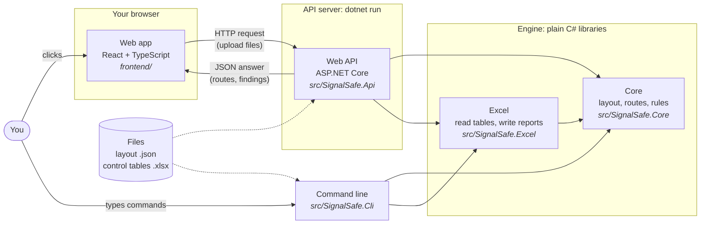
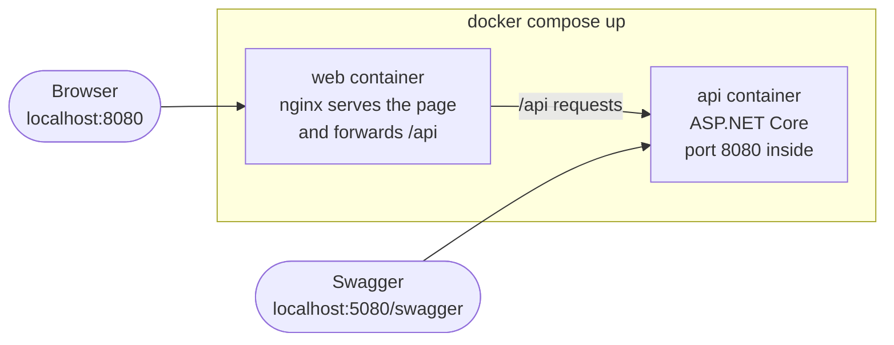
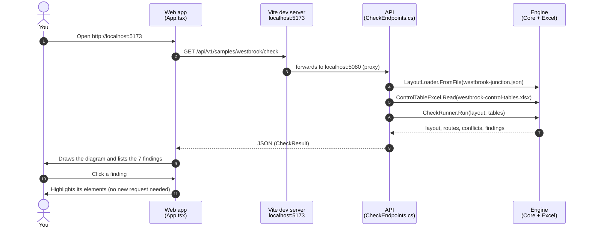
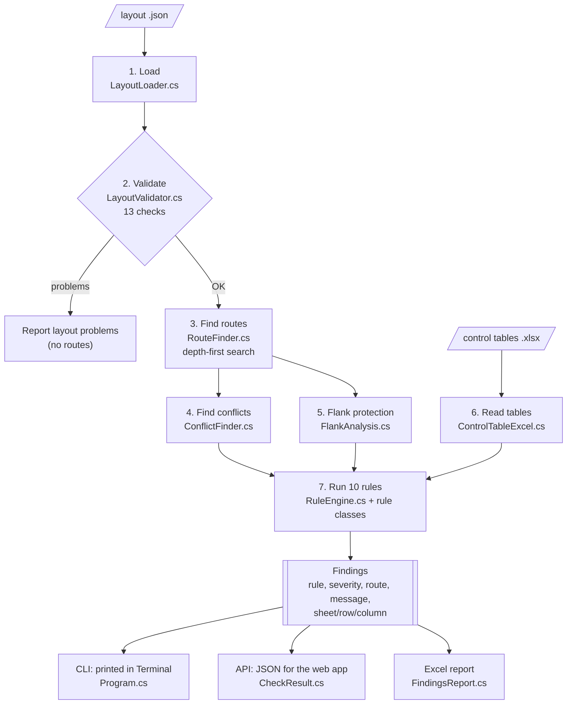
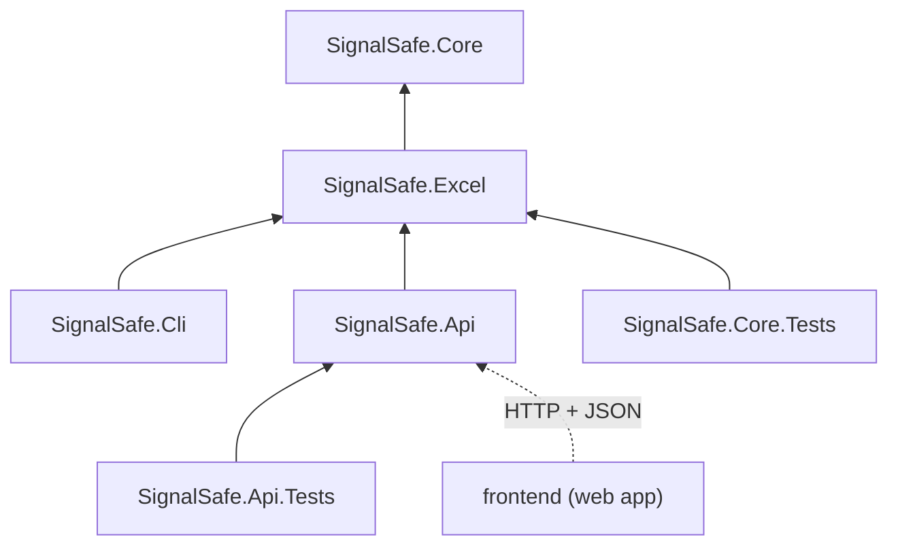
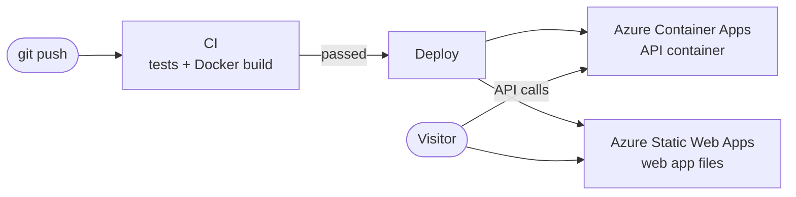

# How SignalSafe works

This guide explains how the pieces of SignalSafe fit together, which file does what, and in what order to read the code. The diagrams are drawn by GitHub automatically.

Related guides: [documentation index](README.md) · [project journey](PROJECT-JOURNEY.md) · [development workflow](WORKFLOW.md) · [deployment](DEPLOYMENT.md) · [glossary](GLOSSARY.md).

## 1. The big picture

SignalSafe has one **engine** (the railway logic, in C#) and three ways to use it.

| Piece | What it is | Why it exists |
| --- | --- | --- |
| **Core** | A C# library with all the railway logic | One place for the logic, so every way of using SignalSafe gives the same answers |
| **Excel** | A C# library that reads and writes `.xlsx` files | Keeps file formats out of the core, so the core stays simple and easy to test |
| **Command line (CLI)** | A small program you run in Terminal | Quick checks without a browser (Weeks 1 and 2) |
| **Web API** | A small web server that runs the engine when asked | Lets a web page (or any program) use the engine over the internet |
| **Web app** | The page you see in the browser | The visual interface: track diagram, findings, routes, simulator |

The same pieces run in three places:

| Where | How to start it | Web app | API |
| --- | --- | --- | --- |
| Your Mac, for development | Two Terminal windows (section 3) | http://localhost:5173 | http://localhost:5080 |
| Your Mac, with Docker | `docker compose up --build` | http://localhost:8080 | http://localhost:5080 |
| Azure (live) | Automatically, after every push that passes CI | [Live demo](https://white-ground-095510a0f.8.azurestaticapps.net/) | [API docs](https://signalsafe-api.bluedesert-a11ee586.uksouth.azurecontainerapps.io/swagger) |

## 2. Words you will see

| Word | Plain meaning |
| --- | --- |
| **API** (Application Programming Interface) | A set of addresses a program can call to ask for something. Here: "check these files" → "here are the findings". |
| **Endpoint** | One of those addresses, for example `GET /api/v1/samples` (list the samples) or `POST /api/v1/check` (check uploaded files). |
| **HTTP** | The language browsers and servers talk. `GET` asks for something; `POST` sends something (like uploaded files). |
| **JSON** | A text format for data, like `{"ruleId": "R03", "severity": "Error"}`. The API answers in JSON; the layout files are JSON too. |
| **ASP.NET Core** | Microsoft's framework for building web servers and APIs in C#. It handles HTTP so our code only says what each endpoint does. |
| **Swagger / OpenAPI** | OpenAPI is a standard description of an API's endpoints. Swagger UI turns it into a web page where you can read about and **try** each endpoint. Ours is at http://localhost:5080/swagger. |
| **React** | A JavaScript library for building interactive web pages out of components (pieces like "findings panel" or "schematic"). |
| **TypeScript** | JavaScript with types, a bit like C#. It catches mistakes before the code runs. |
| **Vite** | The tool that runs the web app during development (`npm run dev`) and builds it for publishing (`npm run build`). |
| **npm** | Node.js's package manager: downloads the libraries the web app uses (like NuGet for .NET). |
| **Proxy** | In development, Vite forwards any request starting with `/api` to the API server, so the browser only talks to one address. |
| **CORS** | A browser safety rule: a page can only call an API on another address if that API allows it. Set in `appsettings.json` for when the web app and API are hosted separately. |
| **localhost** | Your own computer. `localhost:5080` is the API; `localhost:5173` is the web app. |

More terms, including railway and cloud ones, are in the [glossary](GLOSSARY.md).

## 3. Why two Terminal windows?

The web app and the API are **two separate programs**, and each keeps running until you stop it:

| Terminal | Command | Program | Address |
| --- | --- | --- | --- |
| 1 | `dotnet run --project src/SignalSafe.Api` | The API server (C#) | http://localhost:5080 |
| 2 | `cd frontend && npm run dev` | The web app development server (Vite) | http://localhost:5173 |

You open the web app's address in the browser. When the page needs data, it asks the API. This split is how most real web products are built: the frontend and the backend can be developed, tested and hosted separately.

**With Docker you need only one command.** `docker compose up --build` builds two containers (small, self-contained packages of each program and everything it needs) and starts them together:

Once SignalSafe is deployed online, these same containers run in the cloud, and nobody needs a Terminal at all.

## 4. What happens when you open the web app

Uploading your own files works the same way, with `POST /api/v1/check` and the files sent in the request. Downloading the report calls `POST /api/v1/check/report`, which returns an Excel file instead of JSON.

## 5. Inside the engine

Every check, from the CLI or the API, goes through the same steps:

| Step | What it does | Example from Westbrook |
| --- | --- | --- |
| 1. Load | Turns the JSON text into C# objects (sections, points, signals) | 13 sections, 2 points, 7 signals |
| 2. Validate | Catches bad data before anything else: duplicate IDs, points wired wrongly | "OK" |
| 3. Find routes | From every signal, follows the track in its direction, both ways at facing points, until the next signal | 5 routes, e.g. `S1(M)-S5` needs P1 Reverse |
| 4. Find conflicts | Pairs of routes that share track or need points in opposite positions; head-on pairs are marked | `S1(M)-S3` and `S1(M)-S5` conflict at T2 and P1 |
| 5. Flank protection | For trailing points, finds the signal or points that stop a movement running into the side of the route | S7 protects `S4(M)-S6` at P4 |
| 6. Read tables | Reads one row per route from the Excel template, with clear errors for bad cells | 4 rows |
| 7. Run rules | Compares what the designer wrote with what the layout needs | 5 errors, 2 warnings |

## 6. Which file does what

### Engine: `src/SignalSafe.Core` (start here)

| Functionality | File |
| --- | --- |
| Track model: sections, points, signals, layout | [`Domain/Layout.cs`](../src/SignalSafe.Core/Domain/Layout.cs) |
| Reading a layout `.json` file | [`Layouts/LayoutLoader.cs`](../src/SignalSafe.Core/Layouts/LayoutLoader.cs) |
| Checking the layout data (codes L01–L13) | [`Layouts/LayoutValidator.cs`](../src/SignalSafe.Core/Layouts/LayoutValidator.cs) |
| **Finding routes (the main algorithm)** | [`Routing/RouteFinder.cs`](../src/SignalSafe.Core/Routing/RouteFinder.cs) |
| Finding conflicting and head-on routes | [`Routing/ConflictFinder.cs`](../src/SignalSafe.Core/Routing/ConflictFinder.cs) |
| Control table model (one row per route) and column names | [`ControlTables/ControlTable.cs`](../src/SignalSafe.Core/ControlTables/ControlTable.cs) |
| Drafting control tables from a layout | [`ControlTables/ControlTableBuilder.cs`](../src/SignalSafe.Core/ControlTables/ControlTableBuilder.cs) |
| Flank protection analysis | [`Rules/FlankAnalysis.cs`](../src/SignalSafe.Core/Rules/FlankAnalysis.cs) |
| Rule engine: finding, severity, rule context, running all rules | [`Rules/RuleEngine.cs`](../src/SignalSafe.Core/Rules/RuleEngine.cs) |
| Rules R01–R04 (routes, points, track clearance) | [`Rules/RouteRules.cs`](../src/SignalSafe.Core/Rules/RouteRules.cs) |
| Rules R05–R09 (conflicts, opposing, overlap, flank, crossover) | [`Rules/LockingRules.cs`](../src/SignalSafe.Core/Rules/LockingRules.cs) |
| Rule R10 (unknown IDs, "did you mean" hints) | [`Rules/DataConsistencyRule.cs`](../src/SignalSafe.Core/Rules/DataConsistencyRule.cs) |

### Excel: `src/SignalSafe.Excel`

| Functionality | File |
| --- | --- |
| Reading control tables, writing the template | [`ControlTableExcel.cs`](../src/SignalSafe.Excel/ControlTableExcel.cs) |
| Writing the findings report | [`FindingsReport.cs`](../src/SignalSafe.Excel/FindingsReport.cs) |

### Command line: `src/SignalSafe.Cli`

| Functionality | File |
| --- | --- |
| `check`, `draft` and `template` commands | [`Program.cs`](../src/SignalSafe.Cli/Program.cs) |

### Web API: `src/SignalSafe.Api`

| Functionality | File |
| --- | --- |
| Starting the server, Swagger, CORS, JSON settings | [`Program.cs`](../src/SignalSafe.Api/Program.cs) |
| **All endpoints** (samples, check, report, draft, template) and upload checks | [`Endpoints/CheckEndpoints.cs`](../src/SignalSafe.Api/Endpoints/CheckEndpoints.cs) |
| The list of built-in samples | [`Endpoints/Samples.cs`](../src/SignalSafe.Api/Endpoints/Samples.cs) |
| The JSON answer shape, and running a check | [`Contracts/CheckResult.cs`](../src/SignalSafe.Api/Contracts/CheckResult.cs) |
| Port (5080) and allowed web addresses | [`Properties/launchSettings.json`](../src/SignalSafe.Api/Properties/launchSettings.json), [`appsettings.json`](../src/SignalSafe.Api/appsettings.json) |

### Web app: `frontend/`

| Functionality | File |
| --- | --- |
| Page layout, state, buttons, upload, downloads | [`src/App.tsx`](../frontend/src/App.tsx) |
| Calling the API | [`src/api/client.ts`](../frontend/src/api/client.ts) |
| Types matching the API's JSON | [`src/api/types.ts`](../frontend/src/api/types.ts) |
| **Track diagram (SVG drawing, highlights, clicks)** | [`src/components/Schematic.tsx`](../frontend/src/components/Schematic.tsx) |
| Drawing maths: signal placement, labels, view box | [`src/diagram/geometry.ts`](../frontend/src/diagram/geometry.ts) |
| Findings list, filters, rules passed | [`src/components/FindingsPanel.tsx`](../frontend/src/components/FindingsPanel.tsx) |
| Routes list | [`src/components/RoutesPanel.tsx`](../frontend/src/components/RoutesPanel.tsx) |
| **Route simulator logic** (set, lock, refuse, occupy) | [`src/sim/interlocking.ts`](../frontend/src/sim/interlocking.ts) |
| Simulator panel (buttons, points status, event log) | [`src/components/SimulatorPanel.tsx`](../frontend/src/components/SimulatorPanel.tsx) |
| Colours and layout | [`src/styles.css`](../frontend/src/styles.css) |
| Dev server and API proxy | [`vite.config.ts`](../frontend/vite.config.ts) |

### Data, tests and automation

| Functionality | Where |
| --- | --- |
| Sample layouts and control tables | [`samples/`](../samples) |
| Regenerating the sample tables | [`tools/make-samples.cs`](../tools/make-samples.cs) |
| Engine tests (routes, rules, Excel) | [`tests/SignalSafe.Core.Tests/`](../tests/SignalSafe.Core.Tests) |
| API tests | [`tests/SignalSafe.Api.Tests/ApiTests.cs`](../tests/SignalSafe.Api.Tests/ApiTests.cs) |
| Web app tests | [`frontend/src/App.test.tsx`](../frontend/src/App.test.tsx), [`frontend/src/diagram/geometry.test.ts`](../frontend/src/diagram/geometry.test.ts) |
| Build and test on every push (GitHub Actions) | [`.github/workflows/ci.yml`](../.github/workflows/ci.yml) |
| API container | [`src/SignalSafe.Api/Dockerfile`](../src/SignalSafe.Api/Dockerfile) |
| Web app container (nginx serves the page and forwards `/api`) | [`frontend/Dockerfile`](../frontend/Dockerfile), [`frontend/nginx.conf`](../frontend/nginx.conf) |
| Start both containers together | [`docker-compose.yml`](../docker-compose.yml) |
| Publish and deploy to Azure after CI passes | [`.github/workflows/deploy.yml`](../.github/workflows/deploy.yml) |
| One-time Azure setup | [`deploy/azure-setup.sh`](../deploy/azure-setup.sh), guide: [DEPLOYMENT.md](DEPLOYMENT.md) |

## 7. How the projects depend on each other

Arrows mean "uses". The core uses nothing else, which is why it is easy to test and reuse (for example, in a future Revit or MicroStation add-in).

## 8. Suggested reading order

Take these one at a time. Each step builds on the one before.

| # | Read | What you will understand | Time |
| --- | --- | --- | --- |
| 1 | [`samples/westbrook-junction.json`](../samples/westbrook-junction.json) with the drawing in [TESTING.md](../TESTING.md#westbrook-junction) | How a layout is described as data | 15 min |
| 2 | [`Domain/Layout.cs`](../src/SignalSafe.Core/Domain/Layout.cs) | The C# objects for that data | 10 min |
| 3 | [`Routing/RouteFinder.cs`](../src/SignalSafe.Core/Routing/RouteFinder.cs) + [`RouteFinderTests.cs`](../tests/SignalSafe.Core.Tests/Routing/RouteFinderTests.cs) | The route search, the heart of the project | 45 min |
| 4 | [`Routing/ConflictFinder.cs`](../src/SignalSafe.Core/Routing/ConflictFinder.cs) | How conflicts and head-on routes are found | 15 min |
| 5 | [`Rules/RuleEngine.cs`](../src/SignalSafe.Core/Rules/RuleEngine.cs), then one rule, e.g. `PointPositionRule` in [`RouteRules.cs`](../src/SignalSafe.Core/Rules/RouteRules.cs) | How a rule compares tables with the layout | 30 min |
| 6 | [`Rules/RuleTests.cs`](../tests/SignalSafe.Core.Tests/Rules/RuleTests.cs) | How each rule is proved: plant one mistake, expect one finding | 20 min |
| 7 | [`Endpoints/CheckEndpoints.cs`](../src/SignalSafe.Api/Endpoints/CheckEndpoints.cs), then try the endpoints at http://localhost:5080/swagger | How the API wraps the engine | 30 min |
| 8 | [`frontend/src/App.tsx`](../frontend/src/App.tsx), then [`Schematic.tsx`](../frontend/src/components/Schematic.tsx) | How the page asks the API and draws the answer | 45 min |
| 9 | [`frontend/src/sim/interlocking.ts`](../frontend/src/sim/interlocking.ts) + its tests | How the simulator sets, locks and refuses routes | 30 min |
| 10 | [`docker-compose.yml`](../docker-compose.yml) and the two Dockerfiles | How the app is packaged to run anywhere | 20 min |

## 9. Try the API yourself with Swagger

1. Start the API: `dotnet run --project src/SignalSafe.Api`.
2. Open http://localhost:5080/swagger. (Or use the [live API docs](https://signalsafe-api.bluedesert-a11ee586.uksouth.azurecontainerapps.io/swagger) with nothing to start.)
3. Click **GET /api/v1/samples/{id}/check**, then **Try it out**, type `westbrook` as the id, and click **Execute**.
4. Scroll down to see the JSON answer: the same data the web app draws.
5. Try **POST /api/v1/check**: choose a layout file (and optionally a tables file) and click **Execute**.

This is a good way to understand what the web app receives, and it is often asked about in interviews ("how did you test your API?").

## 10. Running in the cloud

The live site uses the same containers as Docker on your Mac, hosted on Azure and updated automatically by GitHub Actions:

| Topic | Read |
| --- | --- |
| What each Azure service does, costs, the free credit, credentials, troubleshooting | [DEPLOYMENT.md](DEPLOYMENT.md) |
| How to make a change and get it live, how to roll back | [WORKFLOW.md](WORKFLOW.md) |
