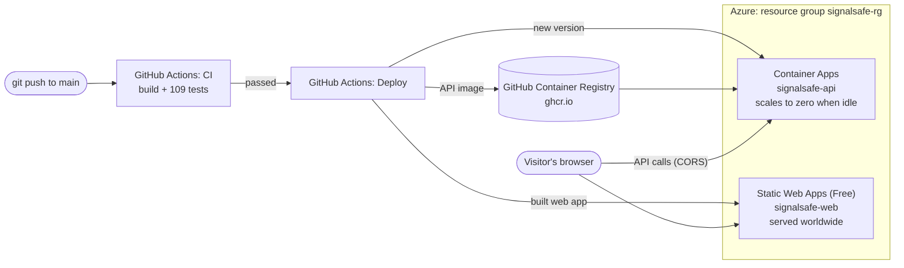
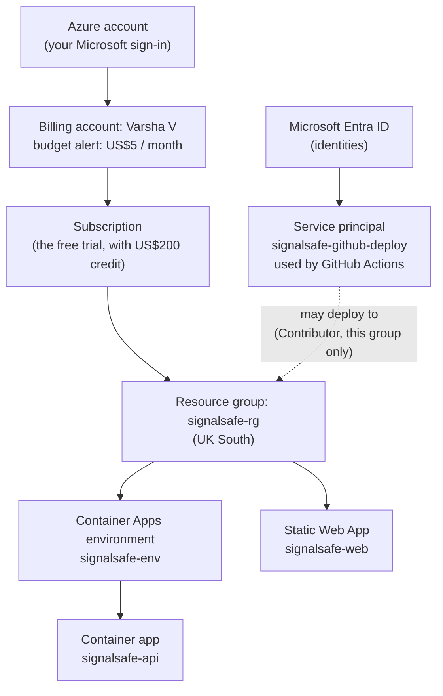
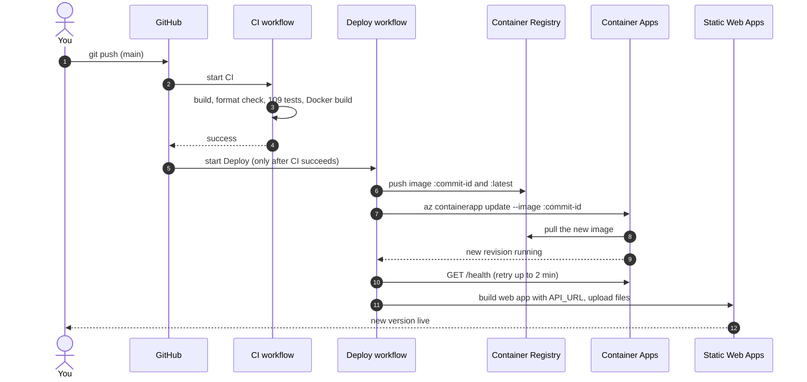

# Deployment: how SignalSafe runs on Azure

SignalSafe is live at:

- **Web app:** https://white-ground-095510a0f.8.azurestaticapps.net/
- **API documentation (Swagger):** https://signalsafe-api.bluedesert-a11ee586.uksouth.azurecontainerapps.io/swagger

This guide has three parts:

1. [**How it works**](#part-1-how-it-works): what runs where, what each Azure service does, and how a change reaches the live site.
2. [**One-time setup**](#part-2-one-time-setup): the steps that were followed to set it up, for reference or to set it up again.
3. [**Looking after it**](#part-3-looking-after-it): costs, the free credit, monitoring, credentials, troubleshooting and removal.

---

# Part 1: How it works

## What runs where



When someone opens the site:

1. Their browser downloads the web app (HTML, JavaScript, CSS) from **Static Web Apps**.
2. The web app calls the API at the Container Apps address, for example `/api/v1/samples/westbrook/check`.
3. **Container Apps** runs the API container. If it was asleep, Azure starts it first (10–20 seconds).
4. The API runs the engine and sends back JSON, which the web app draws.

Locally, nginx (Docker) or Vite forwards `/api` to the API. In Azure, the web app calls the API's full address directly, which is why **CORS** has to allow it (see below).

## How Azure is organised



| Level | What it is | Ours |
| --- | --- | --- |
| **Account** | Your Microsoft sign-in | The account you created |
| **Billing account** | Where costs and budgets are tracked | "Varsha V", with the `signalsafe-budget` alert |
| **Subscription** | A container for resources, linked to a way of paying. All costs are charged to a subscription | The free trial subscription |
| **Resource group** | A folder for related resources. Deleting the group deletes everything in it | `signalsafe-rg`, in UK South |
| **Resources** | The actual services | The four resources below |

## The Azure services, and why each was chosen

| Resource | Azure service | What it does | Why this choice |
| --- | --- | --- | --- |
| `signalsafe-env` | Container Apps **environment** | A shared, managed network and runtime that container apps live in | Required by Container Apps; created without a log workspace to stay free |
| `signalsafe-api` | **Container Apps** | Runs the API's Docker image, gives it an HTTPS address, starts and stops it with demand | Runs any container without managing servers; **scales to zero** when idle, so it costs nothing most of the time |
| `signalsafe-web` | **Static Web Apps** (Free plan) | Hosts the built web app (HTML/JS/CSS) on a global network with HTTPS | Free, fast and simple for a front end that needs no server |
| `signalsafe-github-deploy` | **Service principal** (Microsoft Entra ID) | A non-human identity that GitHub Actions uses to sign in to Azure | Lets GitHub deploy without your password; limited to `signalsafe-rg` only |

Outside Azure:

| Service | What it does |
| --- | --- |
| **GitHub Container Registry** (`ghcr.io/velam-varsha/signalsafe-api`) | Stores the API's Docker images. Public, so Azure can download them without a password, and free |
| **GitHub Actions** | Runs CI (tests) and Deploy (publish and release) |

## Key ideas

**Container and image.** An *image* is a packaged program plus everything it needs to run (here: .NET 10 and the compiled API). A *container* is a running copy of an image. The same image runs on your Mac (Docker), in CI and in Azure, so "it works on my machine" problems disappear. The API image is built by [`src/SignalSafe.Api/Dockerfile`](../src/SignalSafe.Api/Dockerfile) in two stages: build with the full SDK, then copy only the result into a small runtime image that runs as a non-root user.

**Image tags.** Each image is tagged with the **commit ID** it was built from, plus `latest`. Deploying a specific commit ID means you always know exactly which code is live, and you can roll back to any earlier one.

**Revisions.** Each time the container app's image or settings change, Azure creates a new **revision** and switches traffic to it. Older revisions are kept but receive no traffic. You can see them in the portal: container app → **Revisions and replicas**.

**Scale to zero.** The API runs between 0 and 1 copies (replicas). With no visitors it stops, which costs nothing. The first request wakes it, which takes 10–20 seconds.

**Ingress.** Container Apps' built-in front door: it gives the app a public HTTPS address and forwards requests to port 8080 inside the container.

**CORS** (cross-origin resource sharing). Browsers block a page on one address from calling an API on another, unless the API says it is allowed. The setup script sets `Cors__AllowedOrigins__0` on the container app to the web app's address. The double underscore is how environment variables map onto the `Cors:AllowedOrigins` setting in [`appsettings.json`](../src/SignalSafe.Api/appsettings.json).

**Build-time API address.** The web app is plain files with no server, so it cannot read settings when it runs. Instead, the Deploy workflow builds it with `VITE_API_URL` set to the API address, and Vite writes that address into the JavaScript.

**Secrets vs variables (GitHub).** *Secrets* are encrypted, hidden after saving and masked in logs: used for credentials. *Variables* are visible settings: used for addresses and switches.

| Name | Type | Used for |
| --- | --- | --- |
| `AZURE_CREDENTIALS` | Secret | The service principal's sign-in details (JSON) |
| `AZURE_STATIC_WEB_APPS_API_TOKEN` | Secret | Permission to upload files to the Static Web App |
| `API_URL` | Variable | The API address, built into the web app and used for the health check |
| `AZURE_DEPLOY` | Variable | `true` switches the Azure deploy jobs on |

## How a change reaches the live site



The workflow file is [`.github/workflows/deploy.yml`](../.github/workflows/deploy.yml). You can also start it by hand: **Actions → Deploy → Run workflow**.

---

# Part 2: One-time setup

These are the steps that were followed. Use them to set SignalSafe up again (for example, in a new Azure account).

## Step 1: Create an Azure account

1. On https://portal.azure.com, choose **Start with an Azure free trial**, then **Azure free account** ("Try Azure for free"), not Pay as you go.
2. Sign in or create a Microsoft account, then complete the profile, phone check and card check. The card is for identity only; the free account cannot charge you.
3. The portal home page shows your remaining credit and its expiry date.

## Step 2: Set a budget alert

So you get an email if anything ever costs money.

1. Search the portal for **Budgets** and open it. The scope shows your billing account ("Varsha V"); that is fine.
2. Click **+ Add**. Name `signalsafe-budget`, Reset period **Monthly**, leave the dates, Amount **5**. The billing account counts in **US dollars**, so this means US$5. Click **Next**.
3. Add two alert conditions: **Actual 50%** and **Actual 100%**. Enter your email (the one you sign in with is fine). Click **Create**.

A budget only sends emails; it does not stop resources or block charges.

## Step 3: Make the API image public on GitHub

The Deploy workflow publishes the API image after CI passes. Azure must be able to download it.

1. Open https://github.com/velam-varsha?tab=packages and click **signalsafe-api**.
2. **Package settings → Danger Zone → Change visibility → Public**, then type the name to confirm.

## Step 4: Run the setup script in Azure Cloud Shell

Cloud Shell is a terminal in the portal, already signed in to your account.

1. In the portal's top bar, click `>_`. Choose **Bash**; if asked about storage, choose **No storage account required**, pick your subscription and click **Apply**.
2. Paste and press **Enter**:

   ```bash
   curl -fsSL https://raw.githubusercontent.com/velam-varsha/signalsafe/main/deploy/azure-setup.sh | bash
   ```

3. Wait 5–12 minutes. It ends with "Done", the API and web addresses, and four values for GitHub.

What [`deploy/azure-setup.sh`](../deploy/azure-setup.sh) does, in order:

| Step | Command (simplified) | Why |
| --- | --- | --- |
| Check sign-in | `az account show` | Uses the subscription you are signed in to |
| Register services | `az provider register` for `Microsoft.App`, `Microsoft.Web` | New subscriptions must switch services on before first use |
| Resource group | `az group create signalsafe-rg` (UK South) | One folder for everything |
| Environment | `az containerapp env create` with no log workspace | Needed for container apps; no logs keeps it free |
| API app | `az containerapp create` (0.25 CPU, 0.5 GB, 0–1 replicas, port 8080, public HTTPS) | Smallest size, scales to zero |
| Web app | `az staticwebapp create --sku Free`, trying several regions | Some regions refuse new free-trial customers; the first that accepts is used |
| CORS | `az containerapp update --set-env-vars Cors__AllowedOrigins__0=<web address>` | Lets the web app call the API |
| Deploy identity | `az ad sp create-for-rbac --role contributor --scopes <signalsafe-rg>` | GitHub can deploy, but only to this resource group |

The script is safe to run again: existing resources are kept. Running it again does create **new deployment credentials**, so update the `AZURE_CREDENTIALS` secret afterwards.

## Step 5: Give GitHub the values

Repository → **Settings → Secrets and variables → Actions**:

| Tab | Button | Name | Value |
| --- | --- | --- | --- |
| Secrets | New repository secret | `AZURE_CREDENTIALS` | The JSON block the script printed, including `{` and `}` |
| Secrets | New repository secret | `AZURE_STATIC_WEB_APPS_API_TOKEN` | The token the script printed |
| Variables | New repository variable | `API_URL` | The API address, with no `/` at the end |
| Variables | New repository variable | `AZURE_DEPLOY` | `true` |

Never paste the secrets into chat, email, issues, screenshots or code.

## Step 6: Deploy

**Actions → Deploy → Run workflow**. When all three jobs are green, open the web app address. From then on, deployment happens automatically after every push to `main` that passes CI.

---

# Part 3: Looking after it

## Costs and the free credit

| Part | Cost |
| --- | --- |
| Static Web Apps, Free plan | £0 |
| Container Apps, consumption plan, scales to 0 | £0 within the monthly free grant (at the time of writing: 180,000 vCPU-seconds, 360,000 GiB-seconds and 2 million requests per subscription) |
| GitHub Container Registry, public image | £0 |
| GitHub Actions on a public repository | £0 |
| Logs | Not stored, £0 |

Check current prices at https://azure.microsoft.com/pricing.

**The free credit ends on 7 December 2026.** After that, Azure asks you to **upgrade to pay-as-you-go** to keep resources running:

- **If you upgrade:** SignalSafe should still cost nothing, because it stays within the free amounts above. The US$5 budget alert emails you if that ever changes. Check **Cost Management → Cost analysis** once a month for the first few months.
- **If you do not upgrade:** the resources are disabled and the site goes offline. Nothing is charged, and the code stays on GitHub. You can set it up again later with Part 2.

## Watching it

| Want to see... | Where |
| --- | --- |
| Is the API up? | `<API_URL>/health` shows `{"status":"ok"}` (allow 20 seconds if it was asleep) |
| Which version is live | GitHub **Actions → Deploy**: the latest successful run and its commit |
| Revisions, replicas, settings | Portal → **Container Apps → signalsafe-api** → Revisions and replicas / Containers / Ingress |
| Requests and CPU | Portal → signalsafe-api → **Metrics** |
| Web app address and settings | Portal → **Static Web Apps → signalsafe-web** → Overview |
| Spending | Portal → **Cost Management → Cost analysis**, and the budget emails |

Application logs are not stored, to keep costs at zero. To investigate a problem, run the same version locally (Docker or `dotnet run`) and look at the GitHub Actions logs. If you ever need cloud logs, the Container Apps environment can be connected to a Log Analytics workspace, which has a small free monthly allowance.

## Renewing the deployment credentials

The service principal's password (inside `AZURE_CREDENTIALS`) is valid for **one year** from setup (until about November 2027). When it expires, the "Deploy API" job fails with a login error. To renew:

1. Run the setup script again in Cloud Shell (Step 4). It keeps the resources and prints new credentials.
2. Replace the `AZURE_CREDENTIALS` secret in GitHub with the new JSON block.

## Changing settings

All commands run in Azure Cloud Shell.

| Change | Command |
| --- | --- |
| Allow another web address to call the API | `az containerapp update -n signalsafe-api -g signalsafe-rg --set-env-vars Cors__AllowedOrigins__1=https://your-other-site` |
| Keep one copy always running (no wake-up delay, but uses the free grant faster) | `az containerapp update -n signalsafe-api -g signalsafe-rg --min-replicas 1` |
| Go back to scale to zero | `az containerapp update -n signalsafe-api -g signalsafe-rg --min-replicas 0` |
| Roll back the API to an earlier version | `az containerapp update -n signalsafe-api -g signalsafe-rg --image ghcr.io/velam-varsha/signalsafe-api:<commit-id>` |

A custom domain (for example `signalsafe.yourname.dev`) can be added to the Static Web App in the portal under **Custom domains**; the domain itself costs about £10 a year.

## Troubleshooting

| Problem | Fix |
| --- | --- |
| The page says it cannot reach the API | Wait 20 seconds and reload (the API was asleep). If it persists, open `<API_URL>/health`; check `API_URL` has no trailing `/` |
| The page loads but API calls fail with a CORS error (browser console) | The web address changed or is missing from CORS: run the "Allow another web address" command above |
| Setup script: image cannot be pulled | The package is still private: redo Step 3, then run the script again |
| Setup script: "The selected region is currently not accepting new customers" | Azure has no free-trial capacity there. The script tries several Static Web Apps regions; run it again. For the API region: `curl -fsSL <script URL> \| LOCATION=westeurope bash` |
| Setup script: `ad sp create-for-rbac` permission error | Your account must own the subscription; with a personal free account it does |
| Deploy job: `Login failed` | Credentials wrong or expired: see [Renewing the deployment credentials](#renewing-the-deployment-credentials) |
| Deploy jobs are skipped | The variable `AZURE_DEPLOY` must be exactly `true` |
| Deploy didn't run after a push | It only runs when CI passes on `main`. Check the CI run first |

## Removing everything

To delete all SignalSafe resources from Azure (this cannot be undone), run in Cloud Shell:

```bash
az group delete --name signalsafe-rg
```

Also delete the deployment identity, and the GitHub secrets if you no longer need them:

```bash
az ad sp delete --id $(az ad sp list --display-name signalsafe-github-deploy --query "[0].appId" -o tsv)
```
