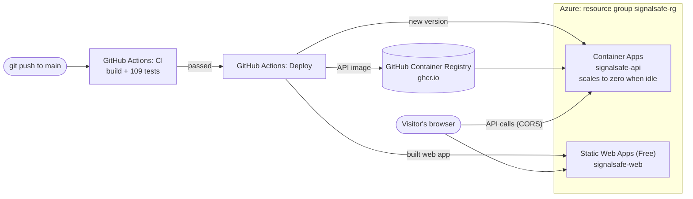

# Deploying SignalSafe to Azure

This puts SignalSafe online with a public link, for £0 within Azure's free allowances. You do the one-time setup (about 20 minutes); after that, every push to `main` that passes CI is deployed automatically.

## What runs where



| Part | Azure service | Cost |
| --- | --- | --- |
| Web app (the page) | Static Web Apps, Free plan | £0 |
| API | Container Apps, consumption plan, 0.25 CPU, scales to 0 | £0 within the monthly free grant |
| API image | GitHub Container Registry (public package) | £0 |
| Logs | Not collected (no Log Analytics workspace) | £0 |

Because the API scales to zero, the **first request after it has been idle takes about 10–20 seconds** while it starts. After that it answers quickly.

## Step 1: Create an Azure account

1. Go to https://azure.microsoft.com/free and sign up. Azure asks for a card **to verify your identity**; the free account cannot charge you during the trial.
2. Sign in at https://portal.azure.com.

## Step 2: Set a budget alert (2 minutes, recommended)

So you get an email if anything ever starts to cost money:

1. In the portal search bar, type **Budgets** and open **Cost Management | Budgets**.
2. Click **+ Add**. Name: `signalsafe`, Reset period: **Monthly**, Amount: **5**.
3. On the next page add an alert at **50%** and **100%** of the budget, with your email address. Click **Create**.

## Step 3: Make the API image public on GitHub

The Deploy workflow publishes the API as a container image to GitHub. Azure needs to be able to download it.

1. Open https://github.com/velam-varsha?tab=packages and click **signalsafe-api**.
   (If it is not there yet, open the repository's **Actions** tab and wait for the **Deploy** workflow's "Publish API image" job to finish.)
2. Click **Package settings** (right-hand side), scroll to **Danger Zone**, click **Change visibility**, choose **Public**, type the name to confirm.

## Step 4: Run the setup script in Azure Cloud Shell

Cloud Shell is a terminal inside the Azure portal, already signed in to your account, so you install nothing.

1. In the portal, click the **Cloud Shell** icon (`>_`) in the top bar. Choose **Bash**. If asked about storage, choose **No storage account required** and your subscription, then **Apply**.
2. Paste this and press Enter:

   ```bash
   curl -fsSL https://raw.githubusercontent.com/velam-varsha/signalsafe/main/deploy/azure-setup.sh | bash
   ```

3. Wait about 5 minutes. At the end it prints your **API** and **Web app** addresses, and four values for GitHub.

The script is in this repository at [`deploy/azure-setup.sh`](../deploy/azure-setup.sh) if you want to read what it does first. Running it again is safe.

## Step 5: Give GitHub the values

In GitHub: open the repository, then **Settings → Secrets and variables → Actions**.

| Tab | Button | Name | Value |
| --- | --- | --- | --- |
| Secrets | New repository secret | `AZURE_CREDENTIALS` | The JSON block the script printed, including `{` and `}` |
| Secrets | New repository secret | `AZURE_STATIC_WEB_APPS_API_TOKEN` | The token the script printed |
| Variables | New repository variable | `API_URL` | The API address, e.g. `https://signalsafe-api.<something>.uksouth.azurecontainerapps.io` |
| Variables | New repository variable | `AZURE_DEPLOY` | `true` |

Secrets are hidden once saved. Never paste them into chat, email, issues or code.

## Step 6: Deploy

1. Open the repository's **Actions** tab, click **Deploy** on the left, then **Run workflow** → **Run workflow**.
2. When all three jobs are green (about 5 minutes), open the **Web app** address from Step 4.

From now on this happens automatically after every push to `main` that passes CI.

## Put it on your CV

- Live demo: your Static Web App address (you can add a custom domain later in the portal).
- API docs: `<API_URL>/swagger`.
- Add the live link at the top of the README.

## Troubleshooting

| Problem | Fix |
| --- | --- |
| The page says it cannot reach the API | Wait 20 seconds and reload (the API was asleep). If it persists, check `API_URL` has no trailing `/` and that `<API_URL>/health` shows `{"status":"ok"}` |
| Setup script: image cannot be pulled | The package is still private: redo Step 3, then run the script again |
| Setup script: `ad sp create-for-rbac` permission error | Your account needs to be the subscription owner; with a personal free account it is |
| Deploy job: `Login failed` | Re-create the `AZURE_CREDENTIALS` secret with the full JSON block, braces included |
| Deploy jobs are skipped | The variable `AZURE_DEPLOY` must be exactly `true` |

## Removing everything

To delete all SignalSafe resources from Azure (this cannot be undone), run in Cloud Shell:

```bash
az group delete --name signalsafe-rg
```
