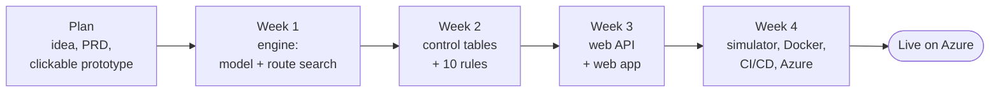

# The SignalSafe journey: how it was built, step by step

This is the story of the project from idea to live website: what was done in each phase, **why each step matters**, and the decisions taken along the way. Read it to understand the project as a whole, or to explain it in an interview.

## At a glance

| Phase | What was built | Result |
| --- | --- | --- |
| Plan | Problem definition, requirements document (PRD), clickable prototype | A clear target before any code |
| Week 1 | Track model, layout checks, route search, conflicts, CLI | 31 tests; engine derives routes correctly |
| Week 2 | Control table import (Excel), 10 rules, findings report | 67 tests; planted mistakes are all caught |
| Week 3 | ASP.NET Core API, React + TypeScript web app | 86 .NET + 13 web tests; usable in a browser |
| Week 4 | Route simulator, Docker, deployment pipeline, Azure | 109 tests; live website, deployed automatically |

## Phase 0: Planning (before writing code)

**What was done**

1. **Chose a problem from real experience.** Checking control tables against scheme plans is slow, manual and safety-critical. Few portfolio projects tackle it, so it stands out.
2. **Wrote a product requirements document (PRD)**: the problem, users, scope (MVP vs later), 32 functional and 18 non-functional requirements, architecture, tech stack, risks and a 4-week plan.
3. **Built a clickable prototype** (a single HTML page) to agree how the app should look before building it.
4. **Researched UK standards** (RSSB and Network Rail). The detailed interlocking rules live in Network Rail's NR/L2/SIG standards, which are not public, so the project uses **simplified rules written in its own words** and cites standard numbers instead of copying text.

**Why it matters**

- A PRD forces decisions early (what is in the MVP, what is not), so the build stays focused. It is also what real teams do before starting work.
- A prototype is cheap to change; code is not. Agreeing the design first avoids rework.
- Using **only invented data** (Westbrook Junction, Kestrel Lane) protects employer and client confidentiality. Never put real project data in a public repository.

## Week 1: The engine core

**What was done**

| Step | Files | Significance |
| --- | --- | --- |
| Created the solution: a class library and a test project | `SignalSafe.sln`, `src/SignalSafe.Core`, `tests/SignalSafe.Core.Tests` | Keeping logic in a library with no UI makes it easy to test and reuse (CLI, API, future CAD add-in) |
| Shared build rules: warnings are errors, code analysis on | `Directory.Build.props`, `.editorconfig` | Catches mistakes early and keeps code consistent |
| Domain model: sections, points, signals | `Domain/Layout.cs` | Turns railway concepts into code; everything else builds on it |
| JSON layout format and loader | `Layouts/LayoutLoader.cs`, `samples/*.json` | A simple, readable input format that anyone can edit |
| Layout validator (13 checks) | `Layouts/LayoutValidator.cs` | Bad input gives clear messages instead of wrong answers |
| **Route search** (depth-first search) | `Routing/RouteFinder.cs` | The heart of the project: the computer works out every route itself |
| Conflict detection | `Routing/ConflictFinder.cs` | Pairs of routes that must never be set together |
| Command-line tool | `src/SignalSafe.Cli/Program.cs` | A way to try the engine before any web app exists |
| GitHub repository and CI | `.github/workflows/ci.yml` | Every push is built and tested automatically |

**Decisions**

- **Graph model**: track sections are edges, joints and points are nodes. Route finding then becomes a standard graph search, a well-known algorithm that is easy to explain and test.
- **Moved from .NET 8 to .NET 10**: .NET 8 support ended in November 2026 and the Mac had the .NET 10 SDK. .NET 10 is the current long-term support (LTS) version.
- **Commits under your own name** (`varsha`) with your GitHub no-reply email, so commits link to your profile without exposing your personal email.

## Week 2: Control tables and the 10 rules

**What was done**

| Step | Files | Significance |
| --- | --- | --- |
| Crossover ends worked together | `RouteFinder.cs` | Matches UK practice: both ends of a crossover always move together |
| Head-on (opposing) conflicts marked | `ConflictFinder.cs` | Distinguishes the most dangerous conflict type |
| Flank protection analysis | `Rules/FlankAnalysis.cs` | Finds what stops a movement running into the side of a route |
| Control table model and drafting | `ControlTables/` | Tables can be generated from a layout, which also gives known-good test data |
| Rule engine and rules R01–R10 | `Rules/` | Each rule is one small class: easy to read, test and extend |
| Excel import and export (separate project) | `src/SignalSafe.Excel` | Designers work in Excel; keeping file formats out of the core keeps it clean |
| Example tables with planted mistakes | `tools/make-samples.cs`, `samples/*.xlsx` | Proves the rules work on realistic input |

**Why it matters**

- Testing each rule the same way ("draft a correct table → plant one mistake → expect exactly one finding") is a strong, repeatable technique. It is good to describe in interviews.
- Clear messages that point to the **sheet, row and column**, plus "did you mean T12?" hints, make the tool useful to a real designer, not just correct.

## Week 3: The web API and web app

**What was done**

| Step | Files | Significance |
| --- | --- | --- |
| Drawing coordinates in the layout file | `samples/*.json` (`diagram` block) | Lets the web app draw the track; the checks never depend on it |
| ASP.NET Core Web API (8 endpoints) | `src/SignalSafe.Api` | Makes the engine available over HTTP to a browser or any program |
| OpenAPI document and Swagger UI | `Program.cs` | The API documents itself and can be tried from a web page |
| API tests (in-memory server) | `tests/SignalSafe.Api.Tests` | Proves each endpoint, including error cases, works |
| React + TypeScript web app | `frontend/` | The visual interface: track diagram, findings, routes |
| Interactive SVG schematic | `Schematic.tsx`, `geometry.ts` | Click a finding to see it on the track; click the track to see its findings |
| Web app tests (Vitest) | `*.test.ts(x)` | The page is tested like the engine |
| Architecture guide | `docs/ARCHITECTURE.md` | Explains how the parts fit together |

**Why it matters**

- **Frontend/backend separation** is how most real products are built. It is why development needs two programs (two Terminal windows): each part can be built, tested and hosted on its own.
- A web app with a live link is far more convincing on a CV than a command-line tool.

## Week 4: Simulator, Docker, CI/CD and Azure

**What was done**

| Step | Files | Significance |
| --- | --- | --- |
| Route simulator | `frontend/src/sim/interlocking.ts`, `SimulatorPanel.tsx` | Shows interlocking behaviour: set, lock, refuse, occupy |
| Dockerfiles and docker-compose | `src/SignalSafe.Api/Dockerfile`, `frontend/Dockerfile`, `docker-compose.yml` | The app runs the same way on any machine and in the cloud |
| CI builds the Docker images | `ci.yml` | Broken Docker files are caught before deployment |
| Deploy workflow | `.github/workflows/deploy.yml` | Every change that passes CI goes live automatically |
| One-time Azure setup script | `deploy/azure-setup.sh` | Creates all cloud resources with one command, repeatably |
| Azure account, budget alert, deployment | Azure portal, GitHub settings | The project is live with a public link |
| Documentation | `docs/` | You can understand, run and maintain the project later |

**Decisions**

- **Azure** rather than other hosts: it matches your goal of cloud integration and is widely used in engineering companies.
- **Container Apps scales to zero** to stay free; the cost is a 10–20 second wake-up after idle time.
- **Static Web Apps region fallback**: West Europe was not accepting new free-trial customers, so the setup script now tries several regions.
- **Deploy only after CI passes**: untested code never reaches the live site.

## What the project demonstrates (for your CV)

| Skill area | Evidence in this project |
| --- | --- |
| C# / .NET | .NET 10 class libraries, records, LINQ, clean architecture |
| Algorithms | Depth-first graph search, conflict and flank analysis |
| Domain modelling | Railway signalling concepts turned into a tested model |
| Rules engine design | 10 rules as separate, testable classes; easy to extend |
| File formats | Excel import/export with ClosedXML; JSON |
| Web APIs | ASP.NET Core minimal APIs, OpenAPI/Swagger, file uploads, CORS |
| Frontend | React 19, TypeScript, SVG graphics, Vite |
| Testing | 109 automated tests: unit, rule, Excel, API and UI tests; ~95% engine coverage |
| DevOps | GitHub Actions CI/CD, Docker, multi-stage builds |
| Cloud | Azure Container Apps, Static Web Apps, GitHub Container Registry |
| Documentation | PRD, architecture, testing, deployment and workflow guides |

## Lessons learned

- **Start with the core and tests**, then add the API and the web app on top. Each layer was simple because the one below was already proven.
- **Tests find real bugs**: a web app test showed that the "did you mean T12?" finding was not linked to T12 on the diagram, and it was fixed.
- **Cloud setup involves things outside the code**: accounts, regions, quotas, currencies (the budget is in US dollars) and secrets. Writing them down (see [DEPLOYMENT.md](DEPLOYMENT.md)) makes them repeatable.
- **Simplify deliberately and say so**: the README lists the simplifications, and the roadmap shows how each would be removed.
