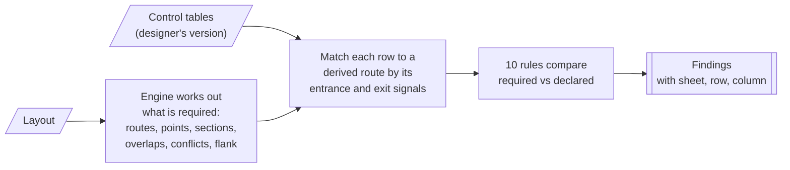

# The checks SignalSafe makes

SignalSafe makes two kinds of checks:

1. **Layout checks (L01–L13)**: is the track layout data itself well formed? These run first. If any fails, no routes are derived and no rules run, because the answers would not be reliable.
2. **Rules (R01–R10)**: do the control tables agree with what the layout requires? Each rule compares what the designer wrote with what the engine worked out from the layout.

> The rules are simplified versions of UK signalling principles, written in this project's own words for a portfolio project. They are not a complete or certified set of signalling checks. See [Simplifications](#simplifications) and the [Roadmap](../README.md#roadmap-how-signalsafe-can-grow).

## How the rules work

- **Matching rows to routes.** A control table row is matched to a derived route by its **entrance and exit signals**, not its name. A designer can use their own route names (for example `S1B` instead of `S1(M)-S5`); conflicting routes may be listed by either name.
- **Severity.** **Error** = the tables do not protect a route the way the layout needs (safety-relevant). **Warning** = something inconsistent that a designer should look at.
- **Where.** Each finding gives the route and, where it comes from a row, the **sheet, row and column**, so the designer can go straight to the cell.

## Summary

| Rule | Name | Checks that... | Severity |
| --- | --- | --- | --- |
| [R01](#r01-missing-route) | Missing route | every route the layout allows is in the control tables | Warning |
| [R02](#r02-impossible-route) | Impossible route | every route in the tables exists in the layout | Error |
| [R03](#r03-point-position) | Point position | each route calls every points on its path, in the right position | Error (Warning for extra points) |
| [R04](#r04-track-clearance) | Track clearance | each route requires every section on its path to be clear | Error (Warning for extra sections) |
| [R05](#r05-conflicting-routes) | Conflicting routes | routes that share track or need opposite points list each other | Error |
| [R06](#r06-opposing-routes) | Opposing routes | routes that would meet head-on list each other | Error |
| [R07](#r07-overlap) | Overlap | each route lists the correct overlap beyond its exit signal | Error |
| [R08](#r08-flank-protection) | Flank protection | points that protect the side of a route are held in the right position | Error (Warning if no protection is possible) |
| [R09](#r09-crossover-pairing) | Crossover pairing | both ends of a crossover are called, in the same position | Error |
| [R10](#r10-data-consistency) | Data consistency | no unknown IDs, duplicates, contradictions or unreadable cells | Warning |

---

## What the engine works out first

The rules compare the tables against these, derived from the layout alone:

| Derived item | How it is worked out | Code |
| --- | --- | --- |
| **Routes** | From every signal, follow the track in the signal's direction (depth-first search). At **facing** points try both Normal and Reverse; at **trailing** points record the position the train needs. The route ends at the next signal reading the same way. | [`RouteFinder.cs`](../src/SignalSafe.Core/Routing/RouteFinder.cs) |
| **Points positions** | Every points on the path with its required position, **plus the other end of any crossover** on the path, in the same position | `RouteFinder.cs` |
| **Track sections** | Every section on the path, in order | `RouteFinder.cs` |
| **Overlap** | The section beyond the exit signal | `RouteFinder.cs` |
| **Conflicts** | Two routes conflict if they share a track section or need the same points in opposite positions | [`ConflictFinder.cs`](../src/SignalSafe.Core/Routing/ConflictFinder.cs) |
| **Opposing (head-on)** | A conflict where the two routes use a shared section in **opposite directions** | `ConflictFinder.cs` |
| **Flank protection** | For each trailing points on a route, walk back along its *other* heel until reaching something that can stop a movement: a signal reading towards the points (held at danger), or points that can be set away | [`FlankAnalysis.cs`](../src/SignalSafe.Core/Rules/FlankAnalysis.cs) |

---

## R01: Missing route

**Checks:** every route the layout allows appears in the control tables.

**Why it matters:** a route that exists on the ground but not in the tables is either forgotten (it will be missing from the interlocking) or deliberately not provided (which should be a recorded decision).

**Finding when:** a derived route has no row with the same entrance and exit signals. **Warning**, because leaving a route out can be intentional.

**Example (Westbrook sample):**
> The layout allows S7(S)-S6 over T20, T10 with P4 Reverse, but it is not in the control tables.

**Code:** `MissingRouteRule` in [`RouteRules.cs`](../src/SignalSafe.Core/Rules/RouteRules.cs)

## R02: Impossible route

**Checks:** every route in the control tables can actually be made on the layout.

**Why it matters:** a table row for a route that cannot exist usually means a wrong signal number, a typo, or tables out of date with the layout.

**Finding when:** a row's entrance and exit are real signals, but no derived route runs between them. **Error.** (If a signal ID is unknown, R10 reports it instead.)

**Example:** a row `S1(M)-S6` with entrance S1 and exit S6:
> S1(M)-S6: there is no route from S1 to S6 in the layout.

**Code:** `ImpossibleRouteRule` in `RouteRules.cs`

## R03: Point position

**Checks:** each route calls every points on its path, in the position the path needs.

**Why it matters:** if points are not called and locked in the right position, a train can be signalled onto the wrong line. This is one of the most safety-critical entries in a control table.

**Finding when:**

| Situation | Severity |
| --- | --- |
| Points on the path are not called at all | Error |
| Points are called in the wrong position (Normal instead of Reverse, or the reverse) | Error |
| The row calls points that are not on the route (they may belong in FlankPoints) | Warning |

The other end of a crossover is checked by R09, not here.

**Example (Westbrook sample):**
> P1 must be Reverse for S1(M)-S5, but the control table calls it Normal. (Routes sheet, row 3, PointsNormal)

**Code:** `PointPositionRule` in `RouteRules.cs`

## R04: Track clearance

**Checks:** each route requires every track section on its path to be clear.

**Why it matters:** the interlocking must prove the route is unoccupied before clearing the signal. A missing section means a train could be signalled into an occupied section.

**Finding when:**

| Situation | Severity |
| --- | --- |
| A section on the path is missing from SectionsClear | Error |
| SectionsClear lists a real section that is neither on the path nor in the overlap | Warning |

**Example (Westbrook sample):**
> S4(M)-S6 runs over T12, but T12 is not listed as a section that must be clear. (Routes sheet, row 5, SectionsClear)

**Code:** `TrackClearanceRule` in `RouteRules.cs`

## R05: Conflicting routes

**Checks:** two routes that share track, or need the same points in opposite positions, each list the other as conflicting.

**Why it matters:** conflicting routes must lock each other out, or two trains could be signalled into the same track.

**Finding when:** a non-opposing conflict pair exists and one row does not list the other route (by its derived or declared name). Each side is checked separately, so a pair listed on neither side gives two findings. **Error.**

**Example (Westbrook sample):**
> S1(M)-S3 and S1(M)-S5 both use T2 and need P1 in opposite positions, but S1(M)-S3 does not list S1(M)-S5 as a conflicting route. (Routes sheet, row 2, ConflictingRoutes)

**Code:** `ConflictingRoutesRule` in [`LockingRules.cs`](../src/SignalSafe.Core/Rules/LockingRules.cs)

## R06: Opposing routes

**Checks:** routes that would meet head-on (using the same section in opposite directions) list each other.

**Why it matters:** this is the most dangerous kind of conflict, a head-on collision risk, so it has its own rule and wording.

**Finding when:** like R05, but for opposing conflict pairs. **Error.**

**Example (Kestrel Lane, if `S31(M)-S43` did not list `S42(M)-S30`):**
> S31(M)-S43 and S42(M)-S30 run head-on over T32, T42, TX, but S31(M)-S43 does not list S42(M)-S30 as a conflicting route.

**Code:** `OpposingRoutesRule` in `LockingRules.cs`

## R07: Overlap

**Checks:** each route lists the overlap the layout gives it beyond the exit signal.

**Why it matters:** the overlap is a safety margin in case a train runs past the exit signal. It must be proved clear (and kept clear) before the route's signal clears.

**Finding when:**

| Situation | Severity |
| --- | --- |
| No overlap listed | Error |
| A different overlap listed | Error |

**Example (Westbrook sample):**
> No overlap is listed beyond exit signal S4. Expected overlap: T12. (Routes sheet, row 4, Overlap)

**Code:** `OverlapRule` in `LockingRules.cs`

## R08: Flank protection

**Checks:** where a route passes over trailing points, the side (flank) of the route is protected, and the table lists any points needed for it in the right position.

**Why it matters:** a movement on the other leg of the points could run into the side of the route. It must be stopped, either by a signal held at danger or by setting other points to lead it away.

**How it is worked out:** from each trailing points on the route, walk back along the other heel:

| Found first | Result |
| --- | --- |
| A signal reading towards the points | Protected by the signal: nothing needed in the table |
| Points that can be set to lead away | Those points must be in **FlankPoints** in that position (e.g. `QR` for Q Reverse) |
| Points that both lead towards the route | Nothing can protect it: Warning (consider trap points) |
| The edge of the layout | Outside the area checked: nothing reported |

**Finding when:**

| Situation | Severity |
| --- | --- |
| Required flank points are not listed | Error |
| Flank points are listed in the wrong position | Error |
| Nothing on the flank line can protect the route | Warning |

**Example (test layout in [`FlankProtectionTests.cs`](../tests/SignalSafe.Core.Tests/Rules/FlankProtectionTests.cs)):**
> Q must be held Reverse to stop movements on F running into the side of S1(M)-S3 at PA, but it is not listed as a flank point.

In the Westbrook sample, the flank of `S4(M)-S6` at P4 is protected by siding signal S7, so no flank points are needed.

**Code:** `FlankProtectionRule` in `LockingRules.cs`, analysis in `FlankAnalysis.cs`

## R09: Crossover pairing

**Checks:** whenever a row calls one end of a crossover, it also calls the other end, in the same position.

**Why it matters:** the two ends of a crossover are worked together. If only one end is called, the other could lie the wrong way and send a train across, or leave the flank of the route unprotected.

**Finding when:**

| Situation | Severity |
| --- | --- |
| One end called, the other not | Error |
| Both ends called, in different positions | Error |

**Example (Kestrel Lane sample):**
> S31(M)-S33 calls P11 Normal but not P12, the other end of the same crossover. Call P12 Normal too. (Routes sheet, row 2, PointsNormal)

**Code:** `CrossoverPairingRule` in `LockingRules.cs`

## R10: Data consistency

**Checks:** the tables only refer to things that exist, have no duplicates or contradictions, and could be read.

**Why it matters:** typos and stale IDs are the most common table errors, and they can hide real problems from the other rules.

**Finding when (all Warnings):**

| Situation | Example |
| --- | --- |
| An ID that is not in the layout (signal, points, section or route), with a "did you mean" hint for likely typos | `SectionsClear lists "T21", which is not a section in the layout. Did you mean T12?` |
| The same route appears more than once | `Route S1(M)-S3 appears more than once (first on row 2).` |
| The same points called both Normal and Reverse | `S1(M)-S3 calls P1 both Normal and Reverse.` |
| A problem reading the file (missing required value, unreadable points position) | `Row 7 has no Exit, so it was skipped.` |

The "did you mean" hint prefers two swapped characters (T21 → T12), then one wrong character, then one missing or extra character, and only suggests when there is exactly one likely match. The suggested element is highlighted on the diagram.

**Code:** [`DataConsistencyRule.cs`](../src/SignalSafe.Core/Rules/DataConsistencyRule.cs)

---

## Layout checks (L01–L13)

These check the layout file before any route is derived. All must pass. **Code:** [`LayoutValidator.cs`](../src/SignalSafe.Core/Layouts/LayoutValidator.cs)

| Code | Checks that... |
| --- | --- |
| L01 | every section, points and signal has an ID, and no ID is used twice |
| L02 | each section has two different ends |
| L03 | each section is longer than 0 m |
| L04 | each points' toe, normal and reverse sections exist |
| L05 | each of those sections actually connects to the points |
| L06 | toe, normal and reverse are three different sections |
| L07 | no other section connects to a set of points |
| L08 | where three or more sections meet, there is a set of points |
| L09 | no signal stands on a set of points |
| L10 | the section a signal protects exists |
| L11 | the section a signal protects starts where the signal stands |
| L12 | a crossover partner (`linkedWith`) exists and is a set of points |
| L13 | crossover partners are linked both ways |

## What the sample tables contain

| Sample | Planted mistakes | Findings |
| --- | --- | --- |
| [Westbrook](../samples/westbrook-control-tables.xlsx) | P1 called Normal on S1(M)-S5; conflicts not listed on S1(M)-S3 and S1(M)-S5; no overlap on S2(M)-S4; "T21" instead of T12 on S4(M)-S6; S7(S)-S6 missing | 5 errors (R03, R04, R05 ×2, R07), 2 warnings (R01, R10) |
| [Kestrel Lane](../samples/kestrel-control-tables.xlsx) | P12 not called on S31(M)-S33 | 1 error (R09) |

The planted mistakes are defined in [`tools/make-samples.cs`](../tools/make-samples.cs), and tests check the exact findings each sample gives.

## How each rule is tested

Every rule is tested the same way in [`RuleTests.cs`](../tests/SignalSafe.Core.Tests/Rules/RuleTests.cs):

1. Draft control tables from the layout. They must give **no findings**.
2. Plant **one** mistake.
3. Expect **exactly the one finding** from that rule.

## Simplifications

These are deliberate for the MVP:

- The overlap is the single section beyond the exit signal (no overlap length in metres, no swinging overlaps, no points in the overlap).
- Conflicts compare route paths only; overlaps are not compared.
- Flank protection is worked out for trailing points only, up to 6 sections back along the flank line.
- A signal reading towards a line end or buffer stop, with no signal beyond, starts no route.
- No approach locking, route holding, sectional release, aspect sequences or timings.
- Rows are matched to routes by entrance and exit signal; if two different paths join the same pair of signals, only the first is matched.

## Standards context

Real GB practice is set out in RSSB standards (for example RIS-0703-CCS, signalling layout and aspect sequences) and Network Rail signalling standards (for example NR/L2/SIG/30009, signalling principles, and NR/L2/SIG/11201 Module A5-3, presentation of control tables). These rules are simplified, written in this project's own words, and reproduce no text from those documents.
