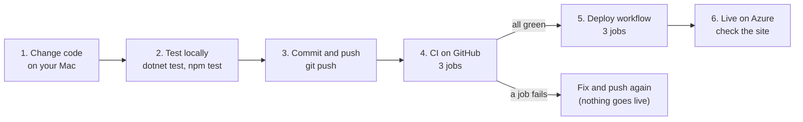

# Development workflow: from a change on your Mac to the live site

This guide explains the everyday process: get the code, change it, test it, push it, and let GitHub and Azure do the rest. It also has worked examples (adding a rule, adding a sample) and how to undo a bad release.

## The whole pipeline



| Stage | Where | What happens | Why it matters |
| --- | --- | --- | --- |
| 1. Change | Your Mac, VS Code | You edit code or data | |
| 2. Test locally | Terminal | Run the tests and try the app | Fastest way to find mistakes, before anyone else sees them |
| 3. Push | Git | Your commits are uploaded to GitHub | GitHub is the single source of truth |
| 4. CI | GitHub Actions ([ci.yml](../.github/workflows/ci.yml)) | Builds everything, checks formatting, runs all tests, builds the Docker images | A safety net: catches anything you missed |
| 5. Deploy | GitHub Actions ([deploy.yml](../.github/workflows/deploy.yml)) | Publishes the API image, updates Azure | Only code that passed CI goes live |
| 6. Live | Azure | The new version is online | Check it in the browser |

CI stands for **continuous integration** (every change is built and tested automatically). CD stands for **continuous deployment** (every change that passes is released automatically). Together they are "CI/CD".

## Step 1: Get the latest code

The first time only:

```bash
git clone https://github.com/velam-varsha/signalsafe.git
```

Every time you start work, go into the folder and get the latest version:

```bash
cd signalsafe
```

```bash
git pull
```

**Why:** someone (or a tool) may have changed the code on GitHub since you last worked. Pulling first avoids conflicts.

## Step 2: Make your change

Open the project in VS Code:

```bash
code .
```

Use [ARCHITECTURE.md](ARCHITECTURE.md#6-which-file-does-what) to find which file does what.

## Step 3: Test locally

Run whichever checks match what you changed. All of them take under a minute.

| You changed... | Run | Expect |
| --- | --- | --- |
| Any C# code or samples | `dotnet test` | `Passed!` for both test projects (86 tests) |
| C# code style | `dotnet format` | Fixes formatting (CI fails if formatting is wrong) |
| The web app | `cd frontend && npm test && npm run lint && npm run build` | 23 tests pass, no lint warnings, build succeeds |
| Anything visible | Run the app (below) and click through it | It looks and behaves right |

Run the app in two Terminal windows:

```bash
dotnet run --project src/SignalSafe.Api
```

```bash
cd frontend && npm run dev
```

Then open http://localhost:5173. Or, with Docker Desktop running, `docker compose up --build` and open http://localhost:8080.

**Why:** a test run on your Mac takes seconds; finding the same problem after deploying takes minutes and affects the live site.

## Step 4: Commit and push

See what changed:

```bash
git status
```

Stage everything and commit with a message that says **what and why**:

```bash
git add -A
```

```bash
git commit -m "Add rule R11: approach locking check"
```

Upload to GitHub:

```bash
git push
```

Your commits use your name and GitHub no-reply email (set once with `git config user.name` and `git config user.email`), so they appear on your GitHub profile.

**Good habits**

- Small commits with clear messages are easier to review and undo.
- Never commit secrets, real project data or files from your employer.
- `git status` before committing shows exactly what will be included. Local test files such as `my-tables.xlsx` in the main folder are ignored automatically (see `.gitignore`).

## Step 5: Watch CI and Deploy

Open the repository's **Actions** tab on GitHub.

**CI** runs first, with three jobs in parallel:

| Job | What it checks |
| --- | --- |
| .NET engine and API | Restore, formatting, build, 86 tests, code coverage summary |
| Web app | Install, lint, 23 tests, production build |
| Docker images | Both Dockerfiles still build |

If **all three** pass on `main`, **Deploy** starts automatically:

| Job | What it does |
| --- | --- |
| Publish API image | Builds the API container and uploads it to GitHub Container Registry, tagged with the commit ID |
| Deploy API to Azure Container Apps | Tells Azure to run the new image, then checks `/health` answers |
| Deploy web app to Azure Static Web Apps | Builds the React app with the live API address and uploads it |

If anything fails, click the red job to read the log, fix the problem on your Mac, and push again. **The live site keeps the previous version until a deploy succeeds.**

Changes to documentation alone still run CI and Deploy. That is harmless: the same code is redeployed.

## Step 6: Check the live site

Open the [live demo](https://white-ground-095510a0f.8.azurestaticapps.net/). If the API has been idle, the first load takes 10–20 seconds. To confirm which version is running, open **Actions → Deploy** and look at the latest successful run's commit.

## Undoing a bad release (rollback)

**The simple way (recommended):** undo the commit and push. CI and Deploy then release the previous behaviour.

```bash
git revert HEAD
```

```bash
git push
```

`git revert` creates a new commit that reverses the last one, so history is kept.

**The fast way (API only):** point Azure back at an earlier image. In Azure Cloud Shell, replace `<commit-id>` with the full commit ID of a good version (from the Actions history):

```bash
az containerapp update -n signalsafe-api -g signalsafe-rg --image ghcr.io/velam-varsha/signalsafe-api:<commit-id>
```

## Worked example: adding a new rule

Every rule follows the same pattern, so adding one is mechanical.

1. **Decide what it checks**, the severity (Error or Warning), and the next free ID (e.g. `R11`).
2. **Write the rule** as a class implementing `IRule` in [`src/SignalSafe.Core/Rules`](../src/SignalSafe.Core/Rules). Copy the shape of a small existing rule such as `OverlapRule` in `LockingRules.cs`: a loop over `ctx.Matches` (each control table row with its derived route) that `yield return`s a `Finding` with a clear message and the sheet/row/column.
3. **Register it** in `RuleEngine.DefaultRules` in [`RuleEngine.cs`](../src/SignalSafe.Core/Rules/RuleEngine.cs).
4. **Test it** in [`RuleTests.cs`](../tests/SignalSafe.Core.Tests/Rules/RuleTests.cs): draft correct tables (no findings), plant one mistake, expect exactly one `R11` finding.
5. **Run** `dotnet test`. Some existing tests count rules (e.g. "10 rules" in the API tests); update those numbers.
6. **Update the docs**: add a section to [RULES.md](RULES.md) and a line to the rules table in the [README](../README.md#the-10-rules).
7. **Commit and push.** The web app shows the new rule automatically, because it lists whatever rules the API returns.

## Worked example: adding a new sample layout

1. Copy `samples/westbrook-junction.json` to a new file and edit sections, points and signals.
2. Check it: `dotnet run --project src/SignalSafe.Cli -- check samples/<your-file>.json`.
3. Add drawing coordinates in the `diagram` block so the web app can draw it. Sections that meet at a node must share the same point (a test checks this for the built-in samples).
4. Draft its control tables: `dotnet run --project src/SignalSafe.Cli -- draft samples/<your-file>.json samples/<name>-control-tables.xlsx`, then plant some mistakes in Excel if you want findings to show.
5. To show it in the web app's sample list, add it to [`Samples.cs`](../src/SignalSafe.Api/Endpoints/Samples.cs) and to `SAMPLE_FILES` in [`App.tsx`](../frontend/src/App.tsx).
6. Test, commit and push.

## Changing the built-in example tables

The example workbooks are generated, so their planted mistakes are documented in code. Edit [`tools/make-samples.cs`](../tools/make-samples.cs), then regenerate them from the repository root:

```bash
dotnet run tools/make-samples.cs
```

Then run `dotnet test`: the tests check the exact findings each sample produces.

## Keeping things up to date

| What | How often | How |
| --- | --- | --- |
| Pull before working | Every session | `git pull` |
| npm packages | Every few months | `cd frontend && npm outdated`, then update and run the tests |
| NuGet packages | Every few months | Update the `Version` numbers in the `.csproj` files, then `dotnet test` |
| Azure deploy credentials | Before they expire (about 1 year after setup) | See [DEPLOYMENT.md](DEPLOYMENT.md#renewing-the-deployment-credentials) |
| Azure free credit | Before it ends | See [DEPLOYMENT.md](DEPLOYMENT.md#costs-and-the-free-credit) |
